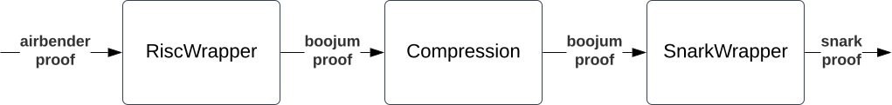

# zkos-wrapper

Vendored into this repository at upstream commit `19fa580`. This copy is the
source of truth from now on: changes are made here, not upstream.

It is a **separate cargo workspace**, so every `cargo` command has to run from
this directory (or with `--manifest-path zkos-wrapper/Cargo.toml`). `boojum` and
`shivini` and friends resolve through `../crypto/` and `../crypto-gpu/` rather
than the branches upstream pins them to; only the airbender crates are
still git dependencies. The header comment in [`Cargo.toml`](./Cargo.toml) says
what that costs.

Library for verifying zkos with boojum

It takes the zkos proof (in json format), and returns the snark proof going through the following steps:




## Docs

See the [docs](./docs/README.md).

## Security

See [SECURITY.md](./SECURITY.md).

## License

Licensed under either of

 * Apache License, Version 2.0, ([LICENSE-APACHE](LICENSE-APACHE) or http://www.apache.org/licenses/LICENSE-2.0)
 * MIT license ([LICENSE-MIT](LICENSE-MIT) or http://opensource.org/licenses/MIT)

at your option.

### Contribution

See [CONTRIBUTING.md](./CONTRIBUTING.md).


### Updating airbender version


If you want to update the airbender dependency, please do these additional steps:
* update Cargo.toml
* re-generate quotients - this can be done by running wrapper_generator: `cargo run --release --bin wrapper_generator`
* update test inputs: from the corresponding air-bender branch:

```shell
# From zksync-airbender directory
cargo run -p cli --release --bin cli -- prove \
    --bin examples/hashed_fibonacci/app.bin \
    --text examples/hashed_fibonacci/app.text \
    --input-file examples/hashed_fibonacci/input.txt \
    --security-level 100 --target recursion-unified \
    --output-dir /tmp/update

# From zkos-wrapper directory.
# The CLI writes a ProofArtifact envelope; the fixture is the inner `proof`
# field (an UnrolledProgramProof), stored as bincode.
jq .proof /tmp/update/proof.json > wrapper/testing_data/risc_proof_100sb
RUST_MIN_STACK=16777216 cargo test convert_risc_proof_from_json -- --ignored --nocapture

# Re-run the full cascade; it rewrites the six downstream fixtures
# (risc_wrapper/compression/snark_wrapper proof+vk). Commit all seven
# *_100sb files together.
RUST_MIN_STACK=67108864 cargo test all_layers_full_test --release -- --nocapture
```

For the `security_80` fixtures (`*_80sb`), pass `--security-level 80` to the
prove command and run the wrapper tests with
`--no-default-features --features security_80`, substituting `80sb` for `100sb`
in the fixture paths. Both modes use `BinaryCommitment::default()` for the
unified-recursion verifier, so any base program works.
